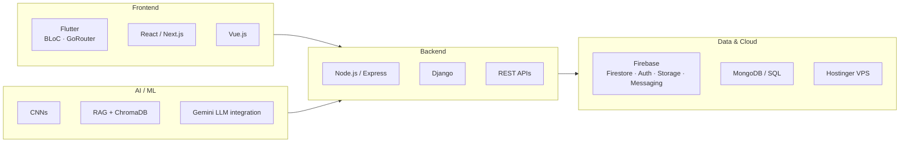

<h1 align="center">Hi, I'm Buraque 👋</h1>

  

  Building practical, locally relevant tech for Pakistan: real estate, legal, education, and healthcare.

---

## 🚀 About Me

- 🎓 Computer Science graduate, **QUEST Nawabshah**
- 🏢 Founder of **Youngdev Interns**, a tech internship and client-services organization
- 🏠 Founder of **Pak Properties**, a bilingual real estate marketplace
- 💼 Former experience at **Qonkar Technologies**
- 🔬 Published researcher: **AI Radiologist** (IJIST, Vol. 7, Issue 10, 2025)
- 🌍 Build bilingual (Urdu/English) products for the Pakistani market
- 📍 Sindh, Pakistan

---

## 🛠️ Tech Stack

  
  
  
  
  
  
  
  
  
  
  
  
  
  
  
  

### Stack at a glance

**Other:** Baileys (WhatsApp API) · client-side encryption (RSA-OAEP + AES-256-GCM) · localization (Easy Localization)

---

## 🌟 Featured Projects

| Project | What it does | Stack | Links |
|---|---|---|---|
| 🩻 **AI Radiologist** | Published research: a hybrid CNN + RAG clinical decision support system. Analyzes CT, MRI, X-ray, and ultrasound scans and generates structured diagnostic reports (94.5% accuracy across ~70,000 training images). | Django, CNN, ChromaDB, RAG, LLM | [Code](https://github.com/Buraquescode/ai-radiologist-showcase) |
| 🏠 **Pak Properties** | Bilingual (Urdu/English) property marketplace for Pakistan, including smaller cities that larger platforms often ignore. Features: Seller Trust Score, Visit Confirm, Mohalla Chat, Deal Witness, Area Price Meter. | Flutter, Firebase, BLoC, Easy Localization | [Code](https://github.com/Buraquescode/pak-properties-showcase) · [Website](https://pakproperties.site/) · [Play Store](https://play.google.com/store/apps/details?id=com.propertypk.property_pk) |
| ⚖️ **District Bar Association Larkana** | Full MERN platform for a legal institution: member directory, dues tracking, media vault, WhatsApp bulk announcements, and an admin CMS. | MERN, Baileys, Hostinger VPS | [Website](https://www.dbalarkana.site/) |
| 📚 **Sindh Online School** | Free bilingual (English/Sindhi) platform organizing YouTube lectures by Class → Subject → Chapter → Topic. | Flutter, Next.js, Firebase | [Code](https://github.com/Buraquescode/sindh-online-school-showcase) |
| 🍽️ **Restaurant POS System** | Point-of-sale and inventory: ingredients, products, suppliers, purchase/sales orders, stock adjustments. | Django | [Code](https://github.com/Buraquescode/restuarant-pos-showcase) |
| 💊 **Pharmacy Management System** | Desktop app for medicine inventory, manufacturer tracking, sales, and receipts. | C#, .NET | [Code](https://github.com/Buraquescode/pharmacy-management-system) |
| 🏢 **Company Management System** | Internal system with real-time currency conversion for sales, finance, projects, and clients. | Django | [Code](https://github.com/Buraquescode/company-managment-showcase) |
| 🇮🇹 **Study in Italy** | Client website for an education consultancy guiding students through Italian university and scholarship applications. | JavaScript | [Code](https://github.com/Buraquescode/itlay-client-project-showcase) |
| 🏫 **QUEST Nawabshah** | Websites for the university's Computer Science department and main site. | Web | — |

---

## 📊 GitHub Stats

  

## 📫 Let's Connect

  
  
  
  

<i>Open to full-stack, mobile, and AI/ML opportunities, and always building something new for Pakistan's tech ecosystem.</i>

